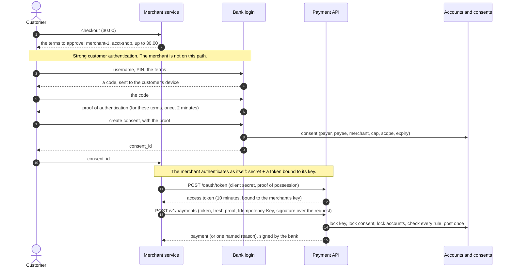

# Architecture: consent, authentication and a once-only payment

Component names match the lesson's diagram ("Consent, authentication and a once-only payment"): the **Customer**, the **Merchant service**, **Bank login**, the **Payment API** and **Accounts and consents**, with the mock bank holding the last three.

## Components and what each owns

| Component | Where it lives | What it owns |
| --- | --- | --- |
| **Customer** | the program [`interfaces/customer_cli.py`](src/open_banking/interfaces/customer_cli.py) | Talks to the bank directly: PIN, then the one-time code, then the consent. Takes the consent id back to the merchant. Never talks to the merchant about credentials. |
| **Merchant service** | [`application/merchant/checkout.py`](src/open_banking/application/merchant/checkout.py), [`interfaces/merchant_api.py`](src/open_banking/interfaces/merchant_api.py), its client [`infrastructure/bank_client.py`](src/open_banking/infrastructure/bank_client.py) | A checkout, and the signed, key-bound, retried call to the bank with the consent id. Holds its own key and secret and nothing of the customer's. No database. |
| **Bank login** | [`application/bank/authentication.py`](src/open_banking/application/bank/authentication.py), [`domain/authentication.py`](src/open_banking/domain/authentication.py), routes `/v1/sca/*` | Strong customer authentication: a PIN, a one-time code bound to the terms, three attempts, five minutes, and a single-use proof when the code is right. Also the customer's revocation. |
| **Payment API** | [`application/bank/access.py`](src/open_banking/application/bank/access.py) (merchant authentication), [`payments.py`](src/open_banking/application/bank/payments.py), [`idempotent.py`](src/open_banking/application/bank/idempotent.py), routes `/oauth/token` and `/v1/payments` | Authenticates the merchant (secret plus proof of possession of a bound key), checks the signed request against the consent, makes the payment once, signs the result. |
| **Accounts and consents** (db) | [`sql/001_schema.sql`](sql/001_schema.sql), [`domain/consent.py`](src/open_banking/domain/consent.py) | Accounts and a double-entry ledger whose balances the database checks against the postings; consents with scope, cap, expiry, revocation and use; payments; idempotency keys scoped to the merchant. |
| **Mock bank's phone** | [`infrastructure/otp.py`](src/open_banking/infrastructure/otp.py) | The stand-in for the customer's device: a file readable by its owner that holds each code. The only place a code exists in clear. |

## Where the trust is

Three trust relationships, three answers:

- **Customer and bank:** strong customer authentication, directly. The bank alone verifies who the customer is and records what they approve. The merchant is not on this path (the diagram's boxes, and the import-linter contract that makes the merchant's code unable to import the bank's authentication code).
- **Merchant and bank:** a client secret **and** a token bound to the merchant's own key, with a fresh proof of possession for every request. This says which merchant is calling; it says nothing about whether this customer approved this payment.
- **Customer and merchant:** the customer trusts the merchant to ask for what was agreed. The bank does not take that on trust: the consent names the merchant, the payee and a cap, and the merchant's request is signed.

## Pattern: layers, ports and adapters, and two sides

The domain (money, the transfer, consent and its rules, the challenge, the signed request, idempotency) imports nothing but the standard library. The application layer is split by side: `application/bank` holds the bank's use cases and its ports (`UnitOfWork` with ten repositories, `Crypto`, `OtpChannel`); `application/merchant` holds the checkout and the `BankGateway` port; `application/ports.py` holds only the clock and the id source that both share. Infrastructure implements the ports with `psycopg`, PyJWT and `cryptography`, a file for the phone, and `httpx` for the merchant's client. Interfaces are the two FastAPI applications, the servers, the programs and the two composition roots. The dependency rule is checked by import-linter in `make lint`, with two more contracts: the domain and application import no framework or crypto library, and the merchant side cannot reach the bank's authentication, consent or payment code. Decisions: [ADR 0001](docs/adr/0001-consent-exists-only-against-a-proof-of-strong-authentication.md) to [0005](docs/adr/0005-the-merchant-cannot-see-the-bank-side.md).

## Data flow of one payment (`make run`, sections 4 and 5)

Drawn versions of this figure and of the walk-through: [the architecture](docs/diagrams/architecture.svg) and [one run](docs/diagrams/flow.svg).

1. The merchant's client asks for a token if it has none (or the old one is about to expire): `POST /oauth/token` with the secret and a proof signed by its key. The bank verifies the secret (a slow hash), the proof (signature, method, URL, time, id not seen before), and issues an opaque token whose digest, key thumbprint and expiry it stores.
2. For the payment the client signs the canonical request (merchant, consent, payee, amount, currency, **idempotency key**) with its key, builds a fresh proof of possession that names the method, the URL and the hash of the token, and sends them with the `Idempotency-Key`.
3. The bank authenticates the caller in its own transaction (token exists, unexpired, bound to the registered key, proof valid and new). The proof's id is stored even if the payment is later refused, so a captured proof cannot be replayed.
4. One transaction does the payment: take the advisory lock on (merchant, key); a stored answer for this request is returned as is (`Idempotent-Replay: true`) and nothing else happens; the same key with another request is `422`.
5. The signature is checked against the merchant's registered key before the consent is read. A changed amount, payee or consent id fails with `request_not_as_signed`.
6. The consent row is locked and every rule is checked in a fixed order, each with its own reason: whose consent, which payee, revoked, expired, already used, currency, amount against the cap, the period cap for a recurring consent.
7. Payer and payee accounts are locked in id order; the payer's balance is checked; the transfer is posted (two postings and two balance updates); the payment and, for a single-payment consent, the use of the consent are recorded; the response is stored under the key. Commit: the database verifies that the entry is a balanced pair and that each balance equals its postings.
8. The response carries the bank's signature over its exact body. The merchant's client verifies it with the bank's published key.

## Decisions and trade-offs

**Consent is an object with a lifecycle**, not a flag: payer, payee, merchant, cap, scope, period, expiry, revocation and use are columns (ADR 0001). A single-payment consent lives ten minutes and pays once; a recurring consent lives ninety days and caps the total in any window of its period.

**The proof is tied to the terms.** A proof for 50.00 cannot create a consent for 5,000.00, and it can be used once.

**Revocation needs one factor.** Withdrawing authority is made easier than granting it.

**Tokens are bound to the merchant's key** (ADR 0002); the proof's id is stored to refuse a replay; the `htu` comes from configuration, not from a header the caller controls.

**Once only and tamper-evident are two mechanisms** (ADR 0003). The idempotency key is scoped to the merchant and stored with the effect; only successes are stored. The signature covers the key.

**Locks in a fixed order** (ADR 0004): key, consent, accounts by id. A payment and a revocation cannot interleave; twenty payments on one single-payment consent make one; payments in opposite directions cannot deadlock.

**The database repeats the rules.** An entry must be two rows summing to zero; a stored balance must equal the sum of its postings at commit; a customer account cannot go below zero; postings cannot be edited; a payment's ledger entry exists once.

**Secrets are stored as hashes and kept out of everything.** PINs and client secrets are scrypt hashes; codes and bearer values are stored as keyed digests (HMAC under a pepper from the environment); private keys are files readable by their owner; no credential appears in the schema's seed, in logs, in an error message or in a response. A test asserts the bank's log output holds none of the PIN, the code, the secret or a token.

**Operability.** Logs are `logfmt` on standard error with ids and reasons, never bodies or headers. `GET /health` checks the database (`503` when down); SIGTERM lets uvicorn finish in-flight requests, run the lifespan shutdown (closing the pool) and exit 0, for both the bank and the merchant, and an end-to-end test checks both exit codes. Settings are read once from the environment and validated; secrets have no defaults and are not printed. The merchant's client retries timeouts and 5xx answers with exponential backoff and the same key.

## Failure modes the lesson teaches, and how to reproduce each

| Failure | What you see | Reproduce |
| --- | --- | --- |
| **Consent without authentication** | `401 invalid_authentication_proof: consent requires strong customer authentication first` | `make run`, section 2 |
| **Abandoned authentication** | The code is sent and never entered: consents before and after are equal; any payment against a made-up id is `consent_not_found` | `make run`, sections 2 and 6; `tests/e2e` |
| **Three wrong codes** | `wrong_code`, `wrong_code`, `challenge_locked` | `make run`, section 2 |
| **A proof used for other terms, or twice** | `401 ... issued for different terms`, `... already used` | `make run`, section 2 |
| **No merchant credential; a stolen token with another key; a replayed proof** | `401 invalid_client_credential` with the cause | `make run`, section 3 |
| **Another merchant's consent** | `403 consent_not_granted_to_caller` | `make run`, section 3 |
| **Over the amount; another payee; after expiry** | `amount_exceeds_consent`, `payee_not_covered`, `consent_expired`, each with its sentence | `make run`, section 4 |
| **A replay** | The same answer with `Idempotent-Replay: true`; the payer is debited once | `make run`, section 5 |
| **A changed amount** | `400 request_not_as_signed: amount does not match approved consent ...` | `make run`, section 5 |
| **Revoked before use** | `403 consent_revoked`; balances unchanged | `make run`, section 6 |
| **The answer is lost after the bank committed** | The merchant retries with the same key and gets `PAID`; one payment | `make run`, section 6 |
| **Every answer is lost** | `BankUnavailableError`, checkout `UNKNOWN`; completing again later gives `PAID`; one payment | `make run`, section 6 |
| **Cap per period** | `period_cap_exceeded` at 110.00 against 100.00; 31 days later a payment passes | `make run`, section 7 |
| **A payment and a revocation at once** | Either the payment came first (its time is at or before the revocation) or it is `consent_revoked`; never both | `make run`, section 7; `tests/integration/test_flows.py` |

## Limits of the teaching build against production

- **The bank is a mock.** One database, one account currency per transfer, no payment scheme, no fraud engine, no reconciliation against a payment rail.
- **The second factor is a file.** A real bank sends to a device; the stand-in is readable by its owner and is the only place a code exists in clear. The PIN is a six-digit number, which a real bank would complement with device binding and rate limits per user, not only per challenge.
- **The merchant's state is in memory.** A restarted merchant forgets its checkouts (the bank still has every payment, and the merchant's key and secret come from the environment). Production keeps checkouts in the merchant's own database.
- **No TLS.** The services speak plain HTTP on localhost; a real deployment terminates TLS and the proof's URL is the public HTTPS URL.
- **The customer's "redirect" is a command.** The customer program stands in for the bank's web page or app.
- **Proof ids are kept forever.** `seen_proofs` grows with every request; production prunes entries older than the clock-skew window, since an older proof is refused by age anyway.
- **Revocation cannot stop a payment that has already committed**, and a merchant that is compromised can still sign any request up to the cap, payee, scope and expiry of a live consent.
- **One signing key for the bank's results**, created on first start and never rotated.
- **A throwaway local database password**, one node.

## How to extend it

- **Open-banking standards:** replace the consent and token shapes with the ecosystem's (consent resources, a hosted login with redirects, FAPI-style signed requests); the ports stay.
- **A real device:** implement `OtpChannel` over a push or SMS service; bind devices; add per-user lockout.
- **Variable recurring payments, standing orders, refunds:** add scopes to `ConsentScope` and rules to `Consent.refusal_for`; every rule is a pure function with a test.
- **Signed webhooks:** the bank calls back with the payment's result, signed with the key already published at `/.well-known/bank-keys.json`; the merchant verifies it exactly as it verifies a direct response.
- **A merchant database:** give the merchant container a repository over its own PostgreSQL schema; nothing else changes.
